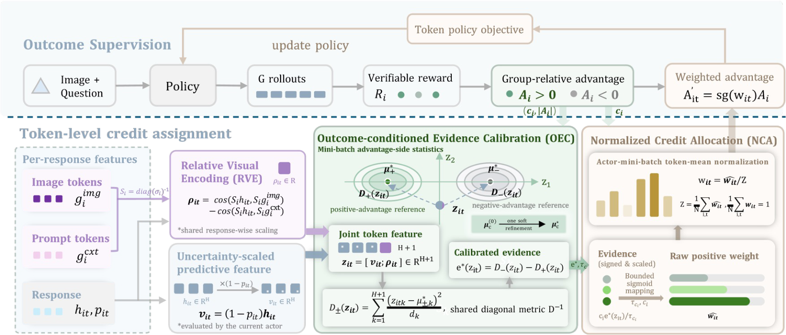
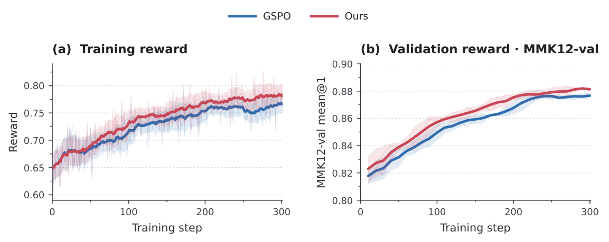

<h1 align="center">OVC: From Visual Affinity to Learning Credit<br>in Multimodal Reinforcement Learning</h1>

<p align="center">
  <a href="https://kawhiiiileo.github.io/OVC_PAGE/"></a>
  <a href="https://kawhiiiileo.github.io/OVC_PAGE/assets/paper.pdf"></a>
</p>

<p align="center">
  Yuhang Han<sup>1,2,3,*</sup>, Dingning Liu<sup>4,*</sup>, Yujie Chen<sup>1,2</sup>, Yaojie Zhang<sup>4</sup>, Jingwei Song<sup>2</sup><br>
  Zequn Yang<sup>2,3</sup>, Xuanming Shang<sup>2,3</sup>, Li Ding<sup>2,3</sup>, Zhijiang Guo<sup>1,†</sup>, Linfeng Zhang<sup>2,†</sup>
</p>

<p align="center">
  <sup>1</sup>The Hong Kong University of Science and Technology (Guangzhou)<br>
  <sup>2</sup>Shanghai Jiao Tong University &nbsp; <sup>3</sup>Shadoweave<br>
  <sup>4</sup>University of Electronic Science and Technology of China<br>
  <sup>*</sup>Equal contribution &nbsp; <sup>†</sup>Corresponding authors
</p>

**OVC turns visual association into outcome-calibrated, token-level learning credit.**
It improves multimodal reinforcement learning using existing rollouts, without
adding a trainable head, auxiliary reward model, process annotations, or
inference-time modules.

[Overview](#overview) · [Results](#results) · [Quick start](#quick-start) ·
[Training](#training) · [Evaluation](#evaluation) · [Citation](#citation)

<a id="overview"></a>

## 🔍 Overview

A multimodal response mixes visual observations with later reasoning. Assigning
the same response-level advantage to every token overlooks these different roles;
simply upweighting image-related tokens can also amplify their negative updates
when later reasoning fails. **Visual affinity is a measurement, not learning credit.**



OVC connects visual association to the observed outcome through three components:

1. **Relative Visual Encoding (RVE)** contrasts a predictive state's affinity to
   image and prompt-context representations, rather than using image affinity alone.
2. **Outcome-conditioned Evidence Calibration (OEC)** combines this coordinate
   with uncertainty-scaled predictive features and calibrates evidence against
   positive- and negative-advantage references, accounting for within-side variation.
3. **Normalized Credit Allocation (NCA)** conditions the calibrated evidence on
   the advantage sign to produce positive token weights with unit global mean.

The policy update uses

```text
A_prime[i, t] = stop_gradient(w[i, t]) * A[i]
```

Here, `stop_gradient` detaches the credit weights from the policy gradient.
The weights preserve advantage signs while changing individual token-gradient contributions.
Our main instantiation uses **GSPO-token**, retaining sequence-level clipping.
See the [method guide](docs/method.md) for the estimator and policy integration,
or the [project page](https://kawhiiiileo.github.io/OVC_PAGE/#method) for an interactive walkthrough.

<a id="results"></a>

## 📊 Results

OVC improves six-benchmark mean accuracy over GSPO by **1.86–2.39 percentage
points** across the three backbones reported in the paper.

| Backbone | Training data | Base | GSPO | GSPO + OVC | Gain over GSPO |
| --- | --- | ---: | ---: | ---: | ---: |
| Qwen3-VL-4B | ViRL39K | 55.91 | 58.67 | **60.71** | **+2.04** |
| Qwen3-VL-8B | ViRL39K | 59.23 | 61.59 | **63.98** | **+2.39** |
| Qwen3.5-9B | Math77K | 67.46 | 68.92 | **70.78** | **+1.86** |

Scores are percentages from the paper. Each mean covers **MMMU, MathVision,
We-Math, MathVista, MMK12-val, and MathVerse**. Comparisons are within a backbone
and training-data setting; individual benchmark gains vary.

<details>
<summary>Full six-benchmark results for Base, GSPO and OVC</summary>

**Qwen3-VL-4B · ViRL39K**

| Benchmark | Base | GSPO | GSPO + OVC |
| --- | ---: | ---: | ---: |
| MMMU | 46.56 | 44.67 | 46.83 |
| MathVision | 21.71 | 24.58 | 26.64 |
| We-Math | 75.52 | 76.52 | 77.05 |
| MathVista | 73.83 | 74.83 | 74.37 |
| MMK12-val | 54.73 | 67.14 | 74.58 |
| MathVerse | 63.12 | 64.29 | 64.80 |
| **Average** | **55.91** | **58.67** | **60.71** |

**Qwen3-VL-8B · ViRL39K**

| Benchmark | Base | GSPO | GSPO + OVC |
| --- | ---: | ---: | ---: |
| MMMU | 48.78 | 44.56 | 49.56 |
| MathVision | 24.67 | 27.30 | 29.93 |
| We-Math | 80.23 | 83.33 | 83.45 |
| MathVista | 74.40 | 76.10 | 76.97 |
| MMK12-val | 64.46 | 74.73 | 78.94 |
| MathVerse | 62.84 | 63.53 | 65.05 |
| **Average** | **59.23** | **61.59** | **63.98** |

**Qwen3.5-9B · Math77K**

| Benchmark | Base | GSPO | GSPO + OVC |
| --- | ---: | ---: | ---: |
| MMMU | 45.67 | 46.78 | 50.33 |
| MathVision | 36.18 | 34.87 | 40.46 |
| We-Math | 87.24 | 87.18 | 88.51 |
| MathVista | 79.20 | 79.20 | 80.30 |
| MMK12-val | 79.09 | 87.74 | 88.28 |
| MathVerse | 77.36 | 77.74 | 76.80 |
| **Average** | **67.46** | **68.92** | **70.78** |

The [paper](https://kawhiiiileo.github.io/OVC_PAGE/assets/paper.pdf) also reports
DelTA, VPPO and AT-RL comparisons, component ablations, and zero-shot transfer.

</details>

### Training dynamics



Qwen3.5-9B on Math77K, as reported in the paper: blue is GSPO and red is OVC.
OVC adds training-time credit estimation; the inference architecture is unchanged.

<a id="quick-start"></a>

## 🚀 Quick start

This release provides **one training recipe: Qwen3.5-9B + GSPO + OVC on Math77K**.
The training backend is FSDP2 with vLLM rollouts, deployed on **16 nodes × 8 GPUs = 128 GPUs**.

### Installation

Use Python 3.12 in a fresh environment with a compatible CUDA driver/toolkit:

```bash
git clone https://github.com/kawhiiiileo/OVC.git
cd OVC
conda create -n ovc python=3.12 -y
conda activate ovc
python -m pip install -r requirements/training.txt
python -m pip install --no-build-isolation flash-attn==2.8.3
python -m pip install --no-deps -e .
```

See the [running guide](docs/reproduction.md) for CUDA dependencies and data preparation.
Model weights and datasets are obtained separately.

### Prepare data

Download [Qwen3.5-9B](https://huggingface.co/Qwen/Qwen3.5-9B) and prepare the
Math77K mathematical subset of DeepVision-103K as parquet with
`problem`, `answer` and `images` columns. Convert it to the training format:

```bash
python recipe/math77k/preprocess.py \
  --input /datasets/math77k/raw.parquet \
  --output-dir /datasets/math77k/ovc \
  --val-size 1024
```

This reserves the first 1,024 rows for `val.parquet` and writes the remaining
rows to `train.parquet`. Keep training and validation examples disjoint.
Use `--val-size 0` if supplying an independently prepared validation parquet.

<a id="training"></a>

## 🛠️ Training

The only preset is [configs/qwen3_5_9b_ovc.json](configs/qwen3_5_9b_ovc.json).
Inspect its resolved paths without loading a model or using GPUs:

```bash
python -m ovc_release.train \
  --model /models/Qwen3.5-9B \
  --train-file /datasets/math77k/ovc/train.parquet \
  --val-file /datasets/math77k/ovc/val.parquet \
  --output /outputs/qwen35-ovc \
  --dry-run
```

Start a dedicated 16-node Ray cluster following the [cluster setup](docs/reproduction.md#cluster-setup).
Replace `--dry-run` with `--launch --ray-address HEAD_IP:6379` to train, running
this command once on the head node. Use a fresh output directory on storage
shared by all nodes. The launcher checks that all 128 Ray GPUs are available,
snapshots the source and starts the distributed FSDP2 engine.

| Setting | Value |
| --- | --- |
| Training GPUs | 16 nodes × 8 GPUs = 128 |
| Prompt / response limit | 4,096 / 16,384 tokens |
| Training batch / rollouts per prompt | 256 / 8 |
| Actor mini-batch / micro-batch per GPU | 64 prompts / 1 response |
| Policy objective | GSPO-token |
| OVC hidden layer / kappa | 16 / 2.0 |
| Training reward | 0.9 answer accuracy + 0.1 format |

The [running guide](docs/reproduction.md) covers resource settings, checkpoints
and source inspection. The [method guide](docs/method.md) explains RVE, OEC and NCA.

<a id="evaluation"></a>

## 🧪 Evaluation

[lmms-eval](https://github.com/EvolvingLMMs-Lab/lmms-eval)

## 📂 Repository layout

```text
configs/qwen3_5_9b_ovc.json  Single training configuration
ovc_release/                OVC tensor utilities, configuration and launcher
verl/                       Qwen3.5-compatible FSDP2 training framework
recipe/math77k/             Data preprocessing and training reward
requirements/               Training dependencies
provenance/                 Training-source SHA-256 inventory
third_party/verl/           Upstream licenses and metadata
docs/                       Method and training guide
tests/                      CPU tests
```

<a id="citation"></a>


## 📝 Citation

If you use OVC in your research, please cite our manuscript:

```bibtex
@misc{han2026ovc,
  title        = {From Visual Affinity to Learning Credit in Multimodal Reinforcement Learning},
  author       = {Han, Yuhang and Liu, Dingning and Chen, Yujie and Zhang, Yaojie and
                  Song, Jingwei and Yang, Zequn and Shang, Xuanming and Ding, Li and
                  Guo, Zhijiang and Zhang, Linfeng},
  year         = {2026},
  howpublished = {Research manuscript},
  url          = {https://kawhiiiileo.github.io/OVC_PAGE/}
}
```

<a id="acknowledgments"></a>

## 🙏 Acknowledgments

We thank [verl](https://github.com/verl-project/verl),
[lmms-eval](https://github.com/EvolvingLMMs-Lab/lmms-eval),
[DelTA](https://github.com/RUCBM/DelTA), and
[VL-Rethinker](https://github.com/TIGER-AI-Lab/VL-Rethinker) for their tools and research.
See [third-party notices](THIRD_PARTY_NOTICES.md) for retained attribution.
